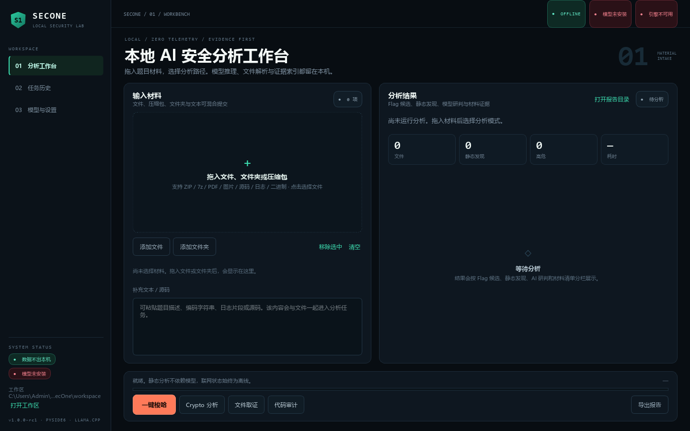
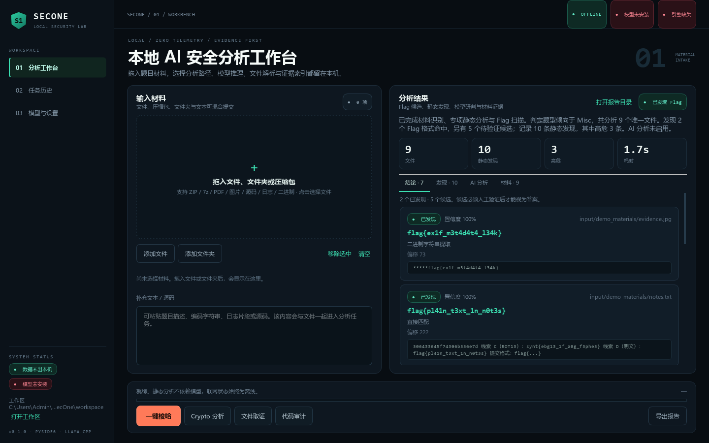
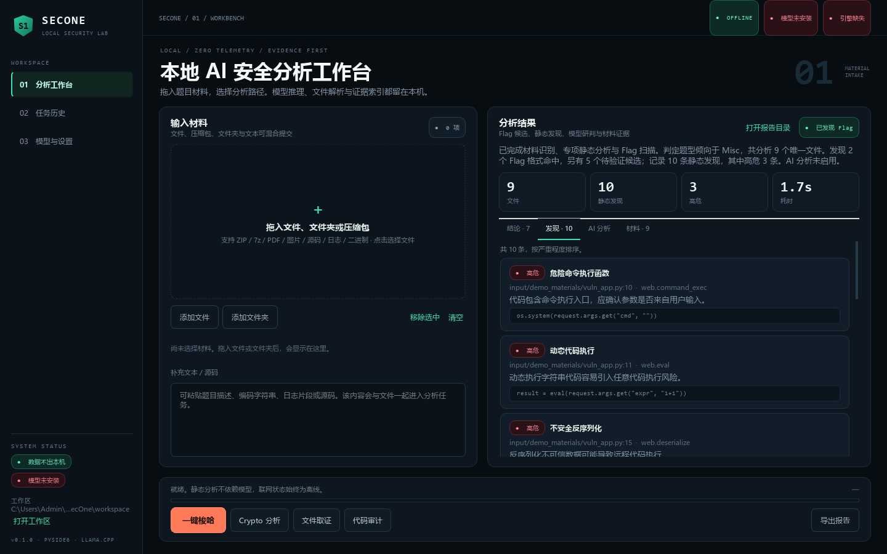
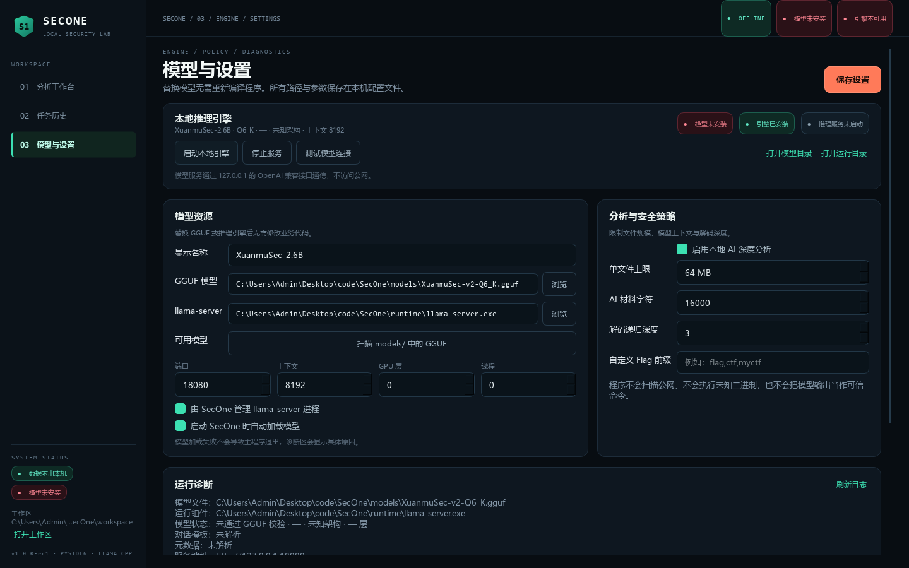
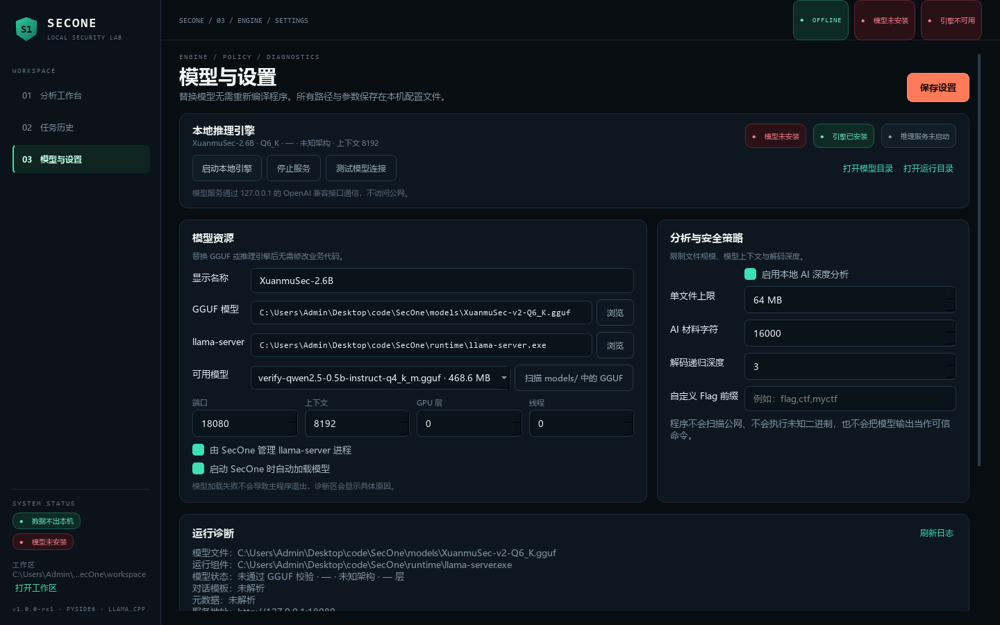
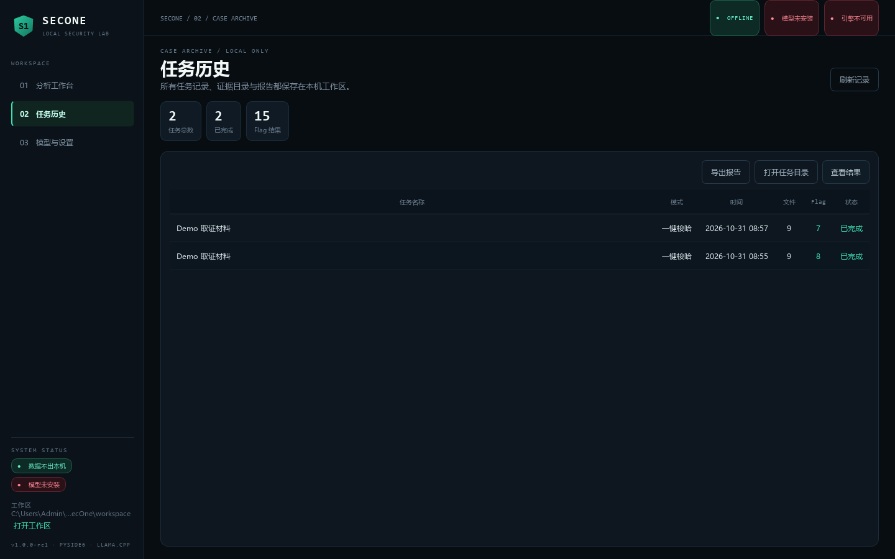

# SecOne · 本地 AI 安全分析工作台

当前版本：**v1.0.0-rc1**（Local Intelligence Workstation）。

[](https://github.com/wakawakalululu/SecOne/actions/workflows/ci.yml)

SecOne 是一个面向 Windows 10/11 x64 的本地、离线优先安全分析桌面工具。它把文件识别、安全解包、静态规则分析、Flag 提取、本地模型研判、证据索引和报告导出串成一条可复现的分析链路，默认不联网、不上传材料。

第一版优先保证“材料进入 → 解包与识别 → 专项静态分析 → Flag 候选与证据 → 报告”的端到端可用性；模型不是运行前提，缺少 GGUF 或 llama.cpp 时静态分析仍可工作，界面会明确显示缺失资源。

## 安全边界

- 只处理用户主动提供的文件、文件夹、压缩包、文本，以及已获授权的题目材料。
- 不自动扫描公网、不发起外部网络探测、不执行用户提供的未知二进制。
- 模型输出只作为分析建议；不会自动执行模型生成的 Shell 命令。当前版本没有开放任意工具调用。
- Flag 候选必须保留来源、偏移、提取方法、证据和置信度。AI 提出的 Flag 只有逐字出现在材料或证据中时才会被接受，且仍标记为“候选”。
- 压缩包解包限制嵌套深度、条目数量、展开体积与单文件体积，拒绝路径穿越、绝对路径和符号链接，并处理加密压缩包与不支持的格式。
- 所有推理通过本机 `127.0.0.1` 上的 llama.cpp OpenAI 兼容接口完成，材料不离开本机。

## 功能

| 模块 | 说明 |
| --- | --- |
| 材料接入 | 拖拽文件/文件夹/压缩包，或粘贴文本；统一复制到任务工作区 |
| 安全解包 | ZIP/TAR/GZip/BZip2/XZ/7z；递归解包；大小、数量、深度限制；RAR 需外部组件 |
| 文件识别 | Magic/扩展名识别、文本编码回退、PDF 文本、图片/EXIF、PCAP、SQLite、PE/ELF 结构 |
| 去重索引 | SHA256 指纹与重复文件去重，记录材料清单 |
| Crypto 分析 | Base64/Base32/Hex/URL/ROT13/ROT47/Atbash/凯撒/仿射/Base58/Base85 递归解码、进制与字符码列表、HTML 实体/Unicode 转义/Quoted-Printable、JS 拼接还原、gzip/zlib 解压、单字节 XOR、RSA 参数与 PEM 识别 |
| Web 审计 | 命令执行、动态执行、文件包含、SQL 拼接、不安全反序列化、硬编码凭据、XSS/SSRF/路径穿越等规则 |
| 文件取证 | 图片元数据、PCAP 头、SQLite schema、PDF 元数据、压缩包清单、熵与字符串 |
| 二进制静态 | PE/ELF 位数、节区、W+X、高熵、Overlay、PIE/NX/RELRO、可疑导入/字符串；不运行样本 |
| Flag 引擎 | `found` / `verified` / `candidate` / `none` 状态；占位符过滤；跨来源去重；证据保留 |
| 本地 AI | llama-server 生命周期管理、GGUF 头校验、健康检查、模型状态与日志诊断 |
| 报告 | Markdown / TXT / JSON、证据索引、候选详情、方法与边界声明 |
| 任务历史 | SQLite WAL 任务库，支持回看结果、打开工作区、导出报告 |

## 界面预览

分析工作台：拖入材料后一键梭哈或按模式分析，结果按 Flag 候选 / 静态发现 / AI 判断 / 材料清单分页展示。



Flag 候选与证据：每个候选保留来源文件、偏移、提取方法与置信度，候选必须经人工确认。



静态发现：Web 审计规则按严重程度排序，直接定位到源码行。



模型与设置：模型路径、llama-server、端口、上下文、GPU 层数与线程数均可在界面修改，无需改代码。



扫描 `models/` 中的 GGUF，选中即写入配置。



任务历史：本机 SQLite 任务库，可回看结果、打开工作区、再次导出报告。



更多说明见[文档中心](docs/wiki/Home.md)（安装部署、使用指南、架构、Flag 引擎、基准评估、打包分发、测试验证、FAQ 共 9 篇，亦可在仓库 Wiki 页签阅读）。

## 快速开始（开发模式）

要求：Windows 10/11 x64，Python 3.11–3.13（本项目使用 3.12）。

```powershell
python -m venv .python
.\.python\Scripts\activate
pip install -r requirements.txt
python run_secone.py
```

项目也支持本地的 `.python\python.exe`；如果已经使用该目录，可直接：

```powershell
.\.python\python.exe run_secone.py
```

首次启动会创建 `data/`、`workspace/`、`output/`、`logs/`，并读取 `config/app.yaml`。界面中的“模型与设置”页可以修改模型路径、llama-server 路径、端口、上下文、GPU 层数与线程数，无需重新编译程序。

## 安装本地模型与推理引擎

SecOne 不附带模型权重，也不附带 llama.cpp 二进制（二者均在 `.gitignore` 中）。

1. 将量化 GGUF 放入 `models/`，默认文件名为 `models/XuanmuSec-v2-Q6_K.gguf`；文件名不同时在设置页修改，或点“扫描 models/ 中的 GGUF”直接选用。
2. 将锁定版本的 `llama-server.exe` 及其依赖 DLL 放入 `runtime/`，默认路径 `runtime/llama-server.exe`。
3. 启动程序，在“模型与设置”页确认：
   - 模型文件通过 GGUF magic/version 校验；
   - 推理引擎存在；
   - 端口未被占用（默认 `18080`）；
   - 点击“启动本地引擎”，健康检查通过后，一键分析会自动调用模型。
4. 如果只做静态分析，可以不安装模型；流水线会跳过 AI 阶段并在结果中注明原因。

### 候选模型与下载选项

设置页“模型资源”区提供**候选模型**下拉框，数据来自 `models/candidates.json`（可自行增删条目）。选中条目会显示架构、建议上下文、说明与获取渠道，并支持“打开下载页”（系统浏览器）与“复制链接”。程序自身不联网下载，保持离线优先：从发布页获取 GGUF 放入 `models/`，再点“扫描 models/ 中的 GGUF”选用即可。

内置候选（截至 v1.0.0-rc1）：

| 模型 | 规模 | 说明 |
| --- | --- | --- |
| XuanmuSec-2.6B `Q6_K` | 约 2.07 GiB | 默认模型，安全领域微调，已完成 RC1 实机链路验证 |
| Qwen2.5-0.5B-Instruct `q4_k_m` | 约 469 MB | 超轻量，低配机器可跑，RC1 验证同款 |
| Qwen3-0.6B | 约 0.5–0.8 GB | Qwen3 系列最小稠密模型，超轻量候选 |
| Qwen3.6-35B-A3B | 35B MoE（激活约 3B） | 2026-04 发布，Apache 2.0，稀疏 MoE 适合家用显卡；需 llama.cpp b8809+ |
| Qwen3.8-27B | 27B 稠密 | 2026-08 开源的原生多模态稠密模型，Apache 2.0 |

Qwen3.6 / Qwen3.8 的 GGUF 量化版可从 ModelScope（如 [unsloth/Qwen3.6-35B-A3B-GGUF](https://www.modelscope.cn/models/unsloth/Qwen3.6-35B-A3B-GGUF)）或 Hugging Face（如 [Qwen/Qwen3.8-27B](https://huggingface.co/Qwen/Qwen3.8-27B)、[lmstudio-community/Qwen3.8-27B-GGUF](https://huggingface.co/lmstudio-community/Qwen3.8-27B-GGUF)）获取。更换任何模型都不需要改动业务代码：新架构以 GGUF 元数据动态识别，不同 llama.cpp 版本的参数差异请以实机验证为准。

模型服务只监听 `127.0.0.1`，使用 OpenAI 兼容接口：

```text
GET  /health
GET  /v1/models
POST /v1/chat/completions
```

模型、运行组件和参数全部来自本地配置文件，替换资源不需要修改业务代码。不同 llama.cpp 版本的参数可能存在差异，升级运行组件后请用实际模型做一次启动与推理验证。

### 已完成的实机验证

推理链路已用**真实 llama-server + 真实 GGUF** 跑通，非模拟：

| 项 | 值 |
| --- | --- |
| llama.cpp | `b12017`（`0.8.0-dev`, commit `5047748f1`），Windows x64 CPU 版 |

正式模型与轻量验证模型均完成实机跑通：

| 模型 | 引擎链路 | 全流水线 | 界面配置链路 |
| --- | --- | --- | --- |
| XuanmuSec-2.6B `Q6_K`（`lfm2`，30 层，131072 上下文，2.07 GiB） | 14/14 | 15/15 | 9/9 |
| Qwen2.5-0.5B-Instruct `q4_k_m`（468.6 MB，`qwen2`） | 14/14 | 15/15 | 9/9 |

引擎链路覆盖启动、`/health`、`/v1/models`、对话、结构化输出与停服释放端口；全流水线覆盖防幻觉、报告导出与 DB 回读；界面链路覆盖扫描 → 选择 → 保存 → 启动 → 推理。

```powershell
.\.python\python.exe scripts\verify_runtime.py --gguf models\XuanmuSec-v2-Q6_K.gguf
.\.python\python.exe scripts\verify_ai_pipeline.py --gguf models\XuanmuSec-v2-Q6_K.gguf
.\.python\python.exe scripts\verify_ui_model_flow.py --gguf models\XuanmuSec-v2-Q6_K.gguf
```

三项脚本均以退出码表示结果，并输出 JSON 报告到 `artifacts/`。上述结果证明模型加载、对话模板、推理与证据链路可用；不代表模型解题准确率。

标准答案解题回归（内部小样本，v4）：

| 项 | 结果 |
| --- | --- |
| 样本 | `benchmarks/ctf_accuracy_v4.json`，60 条 / 41 类：v3 的 24 条原样保留，新增 36 条程序化用例（Base64URL、Base32 无填充、大写冒号 Hex、Base85、UTF-16LE、gzip/zlib、HTML 实体、Unicode 转义、quoted-printable、JS 字符串拼接、字符码列表、凯撒 +7、仿射密码、XOR 0x13 等，答案均不以字面形式出现在材料中） |
| 模型精确命中 | **3/60（5.0%）**：明文、URL 百分号编码、源码注释，均为答案字面可见或模型自行完成百分号解码 |
| 畸形/错误输出 | 15 条计入 `hallucinations`：畸形 flag 形态（嵌套重复 `flag{flag{…`、未闭合、乱码）与格式合法但答案错误（如 `flag{Hello World! This is the flag}`） |
| 耗时 | 766.08s（24 条复用 v3 缓存，其余 36 条实测）；报告 `artifacts/model_accuracy_xuanmusec_v4.json` |
| 确定性引擎对照 | 同一 60 条材料只交给 `FlagEngine`（不加载模型）：**60/60 命中标准答案（100%）**，60/60 无多余候选，全语料 0 个多余候选项；报告 `artifacts/decoder_coverage_v5.json` |

```powershell
.\.python\python.exe scripts\verify_model_accuracy.py --port 18106 --no-reuse
.\.python\python.exe scripts\verify_decoder_accuracy.py
```

两条回归均不能当作正式准确率。模型侧命中仍集中在答案字面可见的题目；确定性解码器现已覆盖 Base64/Base32/Hex/URL/ROT13/ROT47/整段倒序、单字节 XOR、Atbash、凯撒全位移、仿射、Base58/Base85、十进制/八进制/二进制/字符码列表、HTML 实体、Unicode 转义、Quoted-Printable、JS 字符串拼接与数组 join、gzip/zlib 压缩及 UTF-16LE 等机械变换，在 v4 语料上达到全命中且无多余候选。这与产品设计一致：Flag 还原由确定性引擎负责，模型只提供线索，输出必须回到证据中逐字命中才保留为 `candidate`。

## 使用流程

1. 在工作台拖入材料或粘贴题目文本。
2. 选择分析模式：
   - **一键梭哈**：自动识别题型并运行 Crypto、取证、Web、二进制与综合检查，再按需调用本地模型。
   - **Crypto 分析**：编码、古典密码、XOR/RSA 线索与 Flag 扫描。
   - **文件取证**：指纹、元数据、容器结构与字符串。
   - **代码审计**：源码规则审计与危险调用扫描。
3. 查看结果页签：结论（Flag 候选与证据）、发现（静态问题）、AI 分析、材料清单。
4. “导出报告”生成 Markdown/TXT/JSON；报告目录与任务工作区可从界面直接打开。
5. 历史页可以回看任务、载入结果、打开工作区或再次导出报告。

每个任务在 `workspace/<task_id>/` 下保存：

```text
input/        原始材料副本
extracted/    安全解包结果
analysis/     result.json 与中间结果
flags/        candidates.json
evidence/     index.json
report/       report.md / report.txt / report.json
```

## 结果状态含义

- `found`：规则直接在材料原文中匹配到 Flag 格式。
- `verified`：保留给后续验证器/人工确认流程；当前版本不会自动把候选升级为已验证。
- `candidate`：来自解码、XOR、归档内文本、模型线索等路径，必须人工确认。
- `none`：当前材料未产生可靠结果。

模型提出的候选只有在逐字回查材料、已提取 Flag 或静态发现证据后才会进入列表，并始终保持 `candidate` 状态。占位符（如 `flag{...}`、`flag{your_flag_here}`）会被过滤。

## 项目结构

```text
config/               运行时配置与提示词
models/               GGUF 放置目录与模型清单
runtime/              llama-server 放置目录
assets/               图标资源
src/secone/
  config.py           配置合并与保存
  paths.py            应用根目录、工作区与日志路径
  db.py               SQLite 任务库
  domain.py           领域模型
  core/
    ingest.py         材料接入、安全解包、索引
    classify.py       题型与文件分类
    fileio.py         指纹、编码、文本与字符串
    flag_engine.py    Flag 规则、解码、防幻觉
    report.py         报告生成
    pipeline.py       分析流水线
    plugins/          Crypto / Forensics / Web / Binary / Misc
  llm/                llama-server 管理与 OpenAI 客户端
  ui/                 PySide6 界面、主题、工作线程与页面
scripts/              开发预览、图标与打包辅助脚本
packaging/            Nuitka 与 Inno Setup 打包配置
docs/                 发布说明、测试报告与离线安装文档
tests/                pytest 测试
```

## 测试

```powershell
.\.python\python.exe -m pytest tests -q
```

测试覆盖 Flag 规则与占位符、编码/XOR/古典密码（Atbash、凯撒、仿射）/Base58/Base85/进制与字符码列表/HTML 实体/Unicode 转义/Quoted-Printable/JS 拼接/gzip-zlib/UTF-16LE 恢复、拼接原始串误报抑制、19 正例/13 负例标注语料（规则级 precision/recall 1.0）、AI 线索回查、压缩包路径穿越/条目限制/去重、GGUF 头与元数据解析、模拟 llama-server 推理客户端（含取消中断）、端到端流水线（含任务取消落库）、报告输出、界面冒烟和工作台交互（素材接入、拖拽信号、进度、完成/失败渲染、导出、取消状态机）。

发布材料：

- [发布说明](docs/RELEASE_NOTES.md)
- [测试报告](docs/TEST_REPORT.md)
- [离线安装与部署](docs/OFFLINE_INSTALL.md)
- [工程交付报告](docs/DELIVERY_REPORT.md)
- 依赖锁定：`requirements.lock`
- 发布校验清单：`dist/SHA256SUMS`（141 条，覆盖便携目录、便携 ZIP、安装包与模型资源包）
- 便携分发包：`dist/packages/SecOne-1.0.0-rc1-portable-win64.zip`
- 安装包：`dist/installer/SecOne-1.0.0-rc1-setup.exe`
- 模型资源包：`dist/packages/SecOne-model-XuanmuSec-2.6B-Q6_K.zip`（2,246,914,836 字节，SHA256 `eb77aecd…8e87`；发布方 NOTICE 补齐前仅限内部验收）

RC1 验证状态：107 项测试通过（含 19 正例/13 负例规则级 Flag 标注语料，precision/recall 1.0；含 9 项标准答案基准 harness 离线回归、9 项部署依赖静态审计与 4 项高 DPI 缩放回归）；Nuitka standalone EXE 已构建，发布 ZIP 解压后在最小 PATH（清除 Python 变量）下启动冒烟通过；Inno Setup 安装包已构建并完成隔离安装/启动/卸载验证；`scripts/audit_bundle.py` 对 `dist/SecOne` 的 23 项静态依赖检查全通过（内嵌解释器、Qt 平台插件、VC++ 运行库、许可、首次启动目录、无开发机路径泄漏）；真实 XuanmuSec-2.6B GGUF 的引擎、全流水线与界面链路均已实机通过（14/14、15/15、9/9）；标准答案 60 条小样本解题回归为 3/60（5.0%，内部小样本，不代表正式准确率；同语料确定性解码器扩展后 60/60 全命中、0 多余候选）；干净 Windows 离线验收仍为 BLOCKED，详见发布说明与测试报告。

生成开发截图与演示材料：

```powershell
.\.python\python.exe scripts\dev_preview.py
.\.python\python.exe scripts\dev_demo.py
```

截图输出到 `artifacts/screenshots/`。演示任务会写入本机任务库与工作区。

## 打包

CI/CD：`.github/workflows/ci.yml` 在 Windows / Linux / macOS 三平台矩阵上运行全部测试；`.github/workflows/release.yml` 在推送 `v*` 标签时自动构建三平台便携包（Windows 走 Nuitka standalone + 便携 ZIP，Linux/macOS 走 PyInstaller onedir + tar.gz），生成 SHA256SUMS 并自动附加到对应 GitHub Release（`rc/alpha/beta` 标签自动标记为 Pre-release）。

### 跨平台说明

程序核心不依赖 Windows 专属 API（目录打开走 Qt 标准接口，进程启动带平台回退），代码在三大平台可运行。平台差异集中在推理组件与打包形态：

| 平台 | 打包方式 | 推理引擎 |
| --- | --- | --- |
| Windows 10/11 x64 | Nuitka standalone（`packaging/build_exe.ps1`）+ Inno Setup | `llama-server.exe`（发布方构建） |
| Linux x64/ARM64 | PyInstaller onedir（`packaging/build_unix.sh`）→ tar.gz | 需自备 Linux 版 llama-server 放入 `runtime/` |
| macOS（Apple Silicon/Intel） | PyInstaller onedir（同上脚本）→ tar.gz | 同上；产物未签名，首跑需 `xattr -cr <目录>` |

三平台打包布局一致：`config/`、`assets/`、`licenses/`、`models/`（仅清单与候选列表）、`runtime/`（仅 README）与空运行目录随包，模型权重与 llama.cpp 二进制不入包。

### 1. 主程序（Nuitka standalone）

```powershell
pip install nuitka ordered-set zstandard
powershell -ExecutionPolicy Bypass -File packaging\build_exe.ps1 -Clean
```

脚本使用 `--standalone` 生成 `dist\SecOne\`，把 `config/`、`assets/`、`models/model.json`、许可与说明文件复制到主程序旁边，并创建运行期目录。模型、运行组件与任务数据不塞进主程序。

### 2. 便携 ZIP 与 SHA256 清单

```powershell
Compress-Archive -Path dist\SecOne -DestinationPath dist\packages\SecOne-1.0.0-rc1-portable-win64.zip -Force
```

RC1 实际产物：`dist\packages\SecOne-1.0.0-rc1-portable-win64.zip`（46,901,540 字节，SHA256 `afd838ec78b365f7ecfb0510c9fda045d1acda80fe88bf764bc66855cba83a74`），连同 138 个程序文件、安装包与模型资源包写入 `dist\SHA256SUMS`，共 141 条，已逐条复核一致。包内不含任务库与日志：首次启动才会创建 `data\` 与 `logs\`。解压后直接运行 `SecOne.exe`，不依赖系统 Python。

### 3. 安装包（Inno Setup）

安装 Inno Setup 6 后，用 Inno Setup Compiler 打开 `packaging\SecOne.iss` 并编译，或在命令行执行：

```powershell
iscc packaging\SecOne.iss
```

输出在 `dist\installer\`。安装包只包含主程序与配置，默认安装到 `%LOCALAPPDATA%\Programs\SecOne`（当前用户目录，无需管理员权限，任务数据和证据不会因卸载自动删除）；模型包和 llama.cpp 运行组件按需单独分发。编译前必须先完成上一步，确保 `dist\SecOne\` 存在。

RC1 实际产物：`dist\installer\SecOne-1.0.0-rc1-setup.exe`（32,140,884 字节，SHA256 `49e380b78edef48ed5f9a2245b1e79c75f265c5ff6e383a4ab59c84b7dd46e09`），由 Inno Setup 6.7.4 编译。已在隔离目录完成静默安装验证：145 个文件落盘，安装后的 `SecOne.exe` 与 `dist\SecOne\SecOne.exe` 字节一致（32,806,912 字节，SHA256 `babfc00a…c5fb`），缺失模型时按设计弹出提示，卸载后任务数据与日志目录保留。`scripts\verify_offline_install.ps1` 已将安装→快捷方式→首启→卸载收敛为单条命令，本机自检 9/9 步骤通过；干净机验收使用 `-CleanMachine` 实跑。

### 4. 模型包与校验和

```powershell
.\.python\python.exe scripts\package_model.py `
  --gguf models\XuanmuSec-v2-Q6_K.gguf `
  --runtime-dir runtime `
  --license licenses\LICENSE-XuanmuSec.txt `
  --license licenses\LICENSE-LFM1.0.txt
```

脚本会校验 GGUF 文件头、计算 SHA256、生成带 `model.json`、许可文件与 `SHA256SUMS.txt` 的模型包目录和 ZIP，输出到 `dist\packages\`。模型包内是 `models/`、可选的 `runtime/`、`licenses/` 与 `INSTALL.txt`，解压后合并到 SecOne 安装目录即可。缺少 XuanmuSec / LFM1.0 许可文件时脚本默认拒绝打包；仅在确认条款不适用时才使用 `--allow-missing-model-licenses`。模型与服务组件体积较大，建议作为独立下载项，不要塞进基础安装包。

### 可执行文件名

当前统一使用 `SecOne.exe`。如果发行规范要求其它可执行文件名，修改 `packaging/build_exe.ps1` 中的 `--output-filename` 和 `packaging/SecOne.iss` 中的入口文件名即可，不影响内部模块；装载哪个模型权重同样不改变程序身份。

## 许可与分发

- 本项目代码以 Apache-2.0 发布，完整文本见 [LICENSE](LICENSE)。
- 第三方组件与模型许可说明见 [THIRD_PARTY_NOTICES.md](THIRD_PARTY_NOTICES.md)。
- XuanmuSec 模型涉及 XuanmuSec 自身的 Apache-2.0 声明与基座模型 LFM1.0 License 的叠加关系。分发模型权重前必须逐项核对上游条款，保留全部版权、许可与 NOTICE 文本，不能因为桌面程序打包而忽略基座模型条款。
- 模型权重不随本仓库或基础安装包分发。`licenses/LICENSE-LFM1.0.txt` 是取自 Liquid AI LFM2-2.6B 发布的原文；`licenses/LICENSE-XuanmuSec.txt` 记录发布方声明的 Apache-2.0 许可选择，发布方自己的 NOTICE/版权声明仍需在正式分发权重前补齐，并通过 `scripts/package_model.py` 一并打包。
- PySide6/Qt 以 LGPL 方式动态链接；发行包需保留 Qt 许可文本，并允许用户替换 Qt 动态库。若需要静态链接或修改 Qt，请先评估商业许可或 LGPL 合规方案。

## 已知边界

- RAR 解压依赖外部组件；第一版只保留原文件并给出提示。
- 不执行样本、不动态调试、不做公网扫描、不做漏洞利用。
- 没有模型时 AI 页签只显示跳过原因。
- 报告中的“已验证”状态为后续人工/自动验证流程预留；当前不会把解码结果自动视为答案。
- XuanmuSec-2.6B 的加载、对话模板与推理链路已实机验证；标准答案回归扩至 60 条后为 3/60 精确命中（5.0%，内部小样本），命中仍为明文、源码注释（答案字面出现在材料中）与 URL 百分号编码（模型自行解码），其余 57 条（Base64/Base32/Hex/ROT/倒序/双层编码/古典密码/进制 ASCII/Base58/Base85/压缩/字符码/组合变换/XOR 等）均未解出，并出现 15 条畸形或答案错误的输出。同语料确定性解码器扩展解码族后命中 60/60（100%，无多余候选），说明产品价值主要来自可追溯的解码与证据回查，而非模型直接给出答案。不能由“能回答”推定“能解对”，也不能用这 60 条样本给出正式准确率。

## 本轮修复记录（v1.0.0-rc1 验证阶段）

| 问题 | 处理 |
| --- | --- |
| llama-server 把 GGUF 绝对路径当作 model id 返回，泄漏进报告与界面 | `LLMClient._model_label` 将路径形态 id 归一为配置显示名；`display_label()` 只从配置派生 |
| `licenses/LICENSE-LFM1.0.txt` 缺失，导致模型打包被正确拒绝 | 从上游 `LiquidAI/LFM2-2.6B` 取得原文（10574 字节），逐字保存 |
| 打包只带 `LICENSE-XuanmuSec.txt`/`LICENSE-LFM1.0.txt`，未带其引用的 `Apache-2.0.txt` | 新增 `ALWAYS_BUNDLED_LICENSES`，缺失即终止打包 |
| 分发 llama.cpp 二进制时未附带 MIT 许可文本 | 新增 `RUNTIME_LICENSES`，仅在 `--runtime-dir` 时强制要求 |
| 配置的模型名不存在时界面死锁在“模型文件未安装” | 新增 `discover_models()` 与设置页“扫描 models/ 中的 GGUF”下拉框，选中即写入路径 |
| 打包测试把“许可缺失”写死，许可证补齐后误报失败 | 改为 monkeypatch `REQUIRED_LICENSES`，并新增许可证真实存在/随包分发/上游原文校验测试 |
| 确定性解码器在同语料上仅 32/60 命中，凯撒/Atbash/仿射/Base58/Base85/进制 ASCII/字符码列表/HTML 实体/Unicode 转义/Quoted-Printable/JS 拼接/gzip-zlib/UTF-16LE 未覆盖 | `FlagEngine` 新增上述解码族；解码路径输出统一经 UTF-8 严格解码 + 纯 ASCII 校验过滤；`_walk_text` 增加按已配置规则直接匹配（修复 `console.log("flag{…}")` 被泛化括号形态吞掉）；JS 拼接原始串（`"a"+"b"`）在直扫与解码匹配中按拼接伪影压制；同语料基准升至 **60/60（100%）**、0 多余候选，报告 `artifacts/decoder_coverage_v5.json`，测试增至 107 项 |
