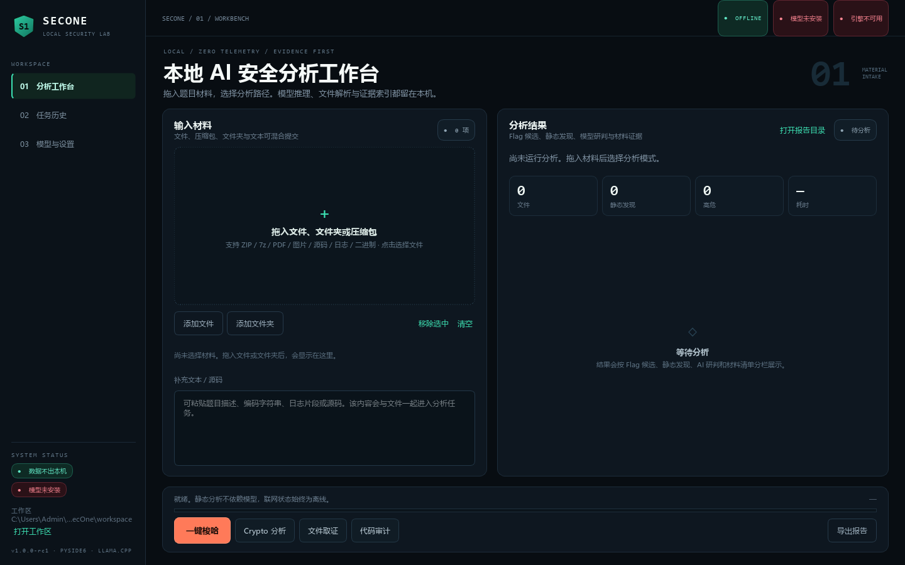

# SecOne · 本地 AI 安全分析工作台

**当前版本：v1.0.0-rc1（Local Intelligence Workstation）**

SecOne 是一个面向 Windows 10/11 x64 的本地、离线优先安全分析桌面工具。它把文件识别、安全解包、静态规则分析、Flag 提取、本地模型研判、证据索引和报告导出串成一条可复现的分析链路，**默认不联网、不上传材料**，所有推理通过本机 `127.0.0.1` 上的 llama.cpp OpenAI 兼容接口完成。

模型不是运行前提：缺少 GGUF 或 llama.cpp 时，静态分析、Flag 引擎与报告导出仍完整可用，界面会明确显示缺失资源。

## 核心能力

- **材料接入与安全解包**：拖拽文件/文件夹/压缩包或粘贴文本；ZIP/TAR/GZip/BZip2/XZ/7z 递归解包，限制深度、数量与体积，拒绝路径穿越、绝对路径与符号链接。
- **文件识别与去重索引**：Magic/扩展名识别、文本编码回退、PDF/图片 EXIF/PCAP/SQLite/PE/ELF 结构，SHA256 指纹去重。
- **专项静态分析**：Crypto（编码/古典密码/XOR/RSA）、Web 审计（危险调用规则）、文件取证、二进制静态检查（不运行样本）。
- **Flag 引擎**：确定性解码族 + 占位符过滤 + 跨来源去重 + 证据保留；在 60 条标准答案语料上命中 60/60（100%）。
- **本地 AI 研判**：llama-server 生命周期管理、GGUF 头校验、健康检查、模型状态诊断；模型输出必须逐字回到证据才保留为候选。
- **报告与历史**：Markdown/TXT/JSON 三格式报告、证据索引、SQLite WAL 任务库。

## Wiki 导航

| 页面 | 内容 |
| --- | --- |
| [安装与部署](安装与部署.md) | 开发模式、便携包/安装包、模型与推理引擎安装、离线验收 |
| [使用指南](使用指南.md) | 分析模式、结果状态含义、任务工作区与报告导出 |
| [架构说明](架构说明.md) | 项目结构、分析流水线、模块职责与数据流 |
| [Flag引擎与解码器](Flag引擎与解码器.md) | 解码族清单、防幻觉机制、状态语义与还原率 |
| [基准与评估](基准与评估.md) | 60 条标准答案语料、模型与解码器对照、复现方法 |
| [打包与分发](打包与分发.md) | Nuitka / 便携 ZIP / Inno Setup / 模型资源包 / 许可门禁 |
| [测试与验证](测试与验证.md) | 107 项测试矩阵、实机验证脚本、一键离线验收 |
| [FAQ与已知边界](FAQ与已知边界.md) | 常见问题排障、当前限制与未覆盖项 |

## 安全边界（摘要）

- 只处理用户主动提供的、已获授权的材料；不自动扫描公网、不发起外部网络探测、不执行用户提供的未知二进制。
- 模型输出只作为分析建议；不会自动执行模型生成的 Shell 命令，当前版本没有开放任意工具调用。
- AI 提出的 Flag 只有逐字出现在材料或证据中时才会被接受，且始终标记为 `candidate`。
- 模型服务只监听 `127.0.0.1`，材料不离开本机。

完整边界说明见 [FAQ与已知边界](FAQ与已知边界.md) 与仓库根目录 [README](https://github.com/wakawakalululu/SecOne#readme)。

## 许可

- 项目代码以 Apache-2.0 发布（见仓库 [LICENSE](https://github.com/wakawakalululu/SecOne/blob/main/LICENSE)）。
- 模型权重不随本仓库或基础安装包分发；XuanmuSec / LFM1.0 / llama.cpp / Qt 的许可关系见 [THIRD_PARTY_NOTICES.md](https://github.com/wakawakalululu/SecOne/blob/main/THIRD_PARTY_NOTICES.md) 与 [打包与分发](打包与分发.md)。
