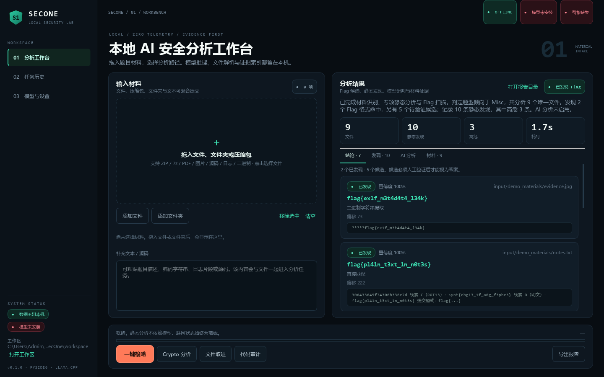
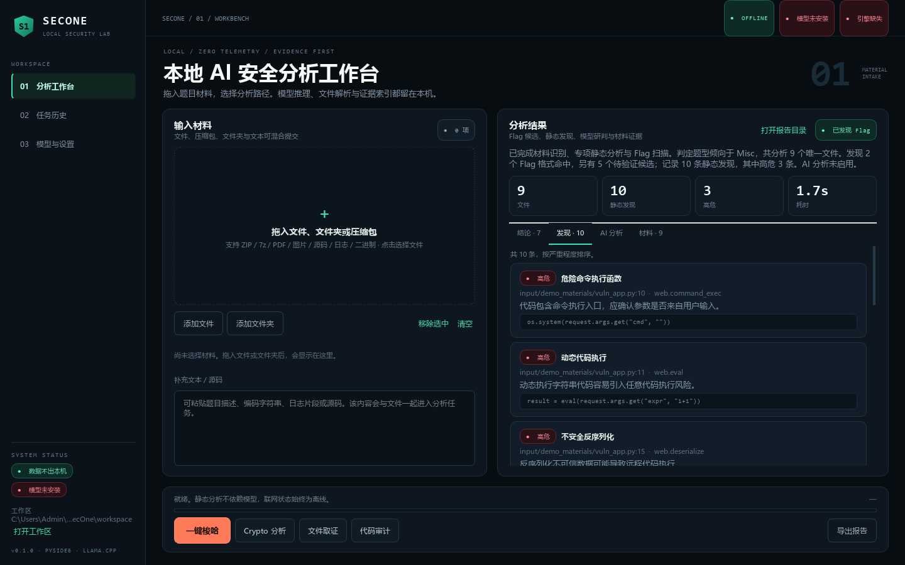
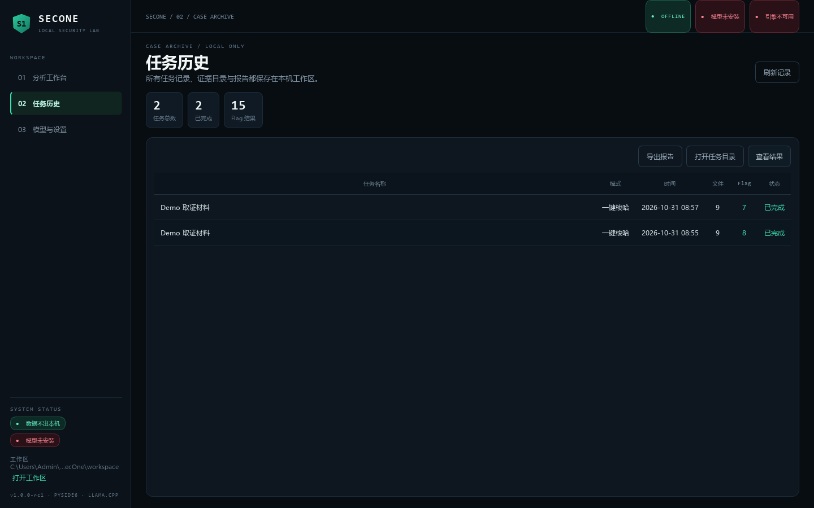

# 使用指南

## 分析流程

1. **接入材料**：在工作台拖入文件/文件夹/压缩包，或粘贴题目文本、源码、日志。所有材料统一复制到任务工作区，不去重不修改原件。
2. **选择分析模式**：
   - **一键梭哈**：自动识别题型，依次运行 Crypto、取证、Web、二进制与综合检查，再按需调用本地模型；
   - **Crypto 分析**：编码、古典密码、XOR/RSA 线索与 Flag 扫描；
   - **文件取证**：指纹、元数据、容器结构与字符串；
   - **代码审计**：源码规则审计与危险调用扫描。
3. **查看结果页签**：结论（Flag 候选与证据）、发现（静态问题）、AI 分析、材料清单。
4. **导出报告**：生成 Markdown/TXT/JSON，报告目录与任务工作区可从界面直接打开。
5. **任务历史**：回看任务、载入结果、打开工作区或再次导出报告。

运行期间可点“取消”：取消采用协作式 `threading.Event`，流水线在每个插件与进度检查点、模型请求等待期间都会响应，取消后任务落库为 `cancelled`，已录入材料保留。

## 结果状态含义

| 状态 | 含义 |
| --- | --- |
| `found` | 规则直接在材料原文中匹配到 Flag 格式 |
| `verified` | 预留给后续验证器/人工确认流程；当前版本不会自动把候选升级为已验证 |
| `candidate` | 来自解码、XOR、归档内文本、模型线索等路径，必须人工确认 |
| `none` | 当前材料未产生可靠结果 |

模型提出的候选只有在逐字回查材料、已提取 Flag 或静态发现证据后才会进入列表，并始终保持 `candidate` 状态。占位符（如 `flag{...}`、`flag{your_flag_here}`）会被过滤。

## 任务工作区

每个任务在 `workspace/<task_id>/` 下保存：

```text
input/        原始材料副本
extracted/    安全解包结果
analysis/     result.json 与中间结果
flags/        candidates.json
evidence/     index.json
report/       report.md / report.txt / report.json
```

每个 Flag 候选保留来源文件、字节偏移、提取方法、解码链、证据原文与置信度，可从界面直接跳转核对。

## 分析限制（config/app.yaml 默认值）

| 项 | 值 | 项 | 值 |
| --- | --- | --- | --- |
| 单任务文件数上限 | 500 | 单文件上限 | 64 MB |
| 材料总体积上限 | 256 MB | 文本字符上限 | 60000 |
| AI 材料字符上限 | 16000 | 解码递归深度 | 3 |
| 解码结果上限 | 80 | 压缩包嵌套深度 | 3 |
| 压缩包条目上限 | 400 | 压缩包总体积上限 | 512 MB |

超限会明确提示并继续处理其余材料，不会静默截断。

## 界面截图






